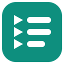

# TubeList

**Replace YouTube's home feed with your own list of things you want to learn.**

When you open YouTube, instead of the algorithm's recommendations you see
*your* list of topics, like "video editing basics" or "how to build a browser
extension". Click one, and YouTube searches for it. Your goals replace the
recommendations.



## Why this exists

It's easy to open YouTube with some free time and no plan, and end up
watching random videos for hours. Hiding recommendations helps, but then you
still don't know *what* to watch, so you drift back to random entertainment.

TubeList makes free time on YouTube intentional. Keep a list of topics you'd
like to explore (fun is fine, but ideally things that grow your skills or
career), and let that list be the first thing you see.

The whole idea is one smooth flow:
**open YouTube → see your list → click a topic → start watching.**

## Features

- **Your topic list** on the YouTube home page, in a clean full-page panel
  that follows YouTube's light and dark mode.
- **Click a topic to search** YouTube for it.
- **Add, edit and delete topics** right on the panel (Edit/Delete appear when
  you hover over a topic) or from the toolbar popup.
- **"Go to normal YouTube"** button, so you're never locked out.
- **Keyboard shortcut** (default **Alt+Shift+Y**) that opens a new YouTube tab
  with the cursor already in the "add a topic" box.
- **Distraction-hiding switches** (all on by default): Shorts, sidebar
  recommendations, end-of-video suggestion cards, and the home feed.
- **Private by design:** no server, no account, no tracking, no network
  requests. Your list is stored only in your browser.

Works in Chrome, Edge, Brave and Firefox (one codebase). Safari isn't
supported.

---

## Installing

TubeList isn't in the extension stores, so you load the folder directly.
First, download this project folder (for example with GitHub's
**Code → Download ZIP**, then unzip it).

### Chrome, Brave, Edge

1. Open the extensions page:
   - Chrome: `chrome://extensions`
   - Brave: `brave://extensions`
   - Edge: `edge://extensions`
2. Turn on **Developer mode** (top right in Chrome/Brave; left side in Edge).
3. Click **Load unpacked** and choose the `TubeList` folder (the one that
   contains `manifest.json`).
4. Click the puzzle-piece icon in the toolbar and **pin** TubeList so its icon
   is always visible.

You may see a note about `browser_specific_settings`. That part is only for
Firefox; Chromium browsers ignore it, and it's harmless.

To update after changing the code: click the round **reload** arrow on the
TubeList card, then refresh your YouTube tabs.

### Firefox

1. Open `about:debugging#/runtime/this-firefox`.
2. Click **Load Temporary Add-on…** and select the `manifest.json` file inside
   the `TubeList` folder.
3. Open YouTube. If the panel doesn't appear, click the puzzle-piece icon,
   find TubeList, and choose **Always allow on www.youtube.com**, then refresh.

Firefox removes temporary add-ons when it closes, so you'll repeat these
steps after restarting Firefox (and your list may start fresh). Installing it
permanently in regular Firefox requires the add-on to be signed by Mozilla.

---

## Using your topic list

- **Open YouTube's home page** (youtube.com) and your list appears.
- **Click a topic** to search YouTube for it. Middle-click or Ctrl+click opens
  it in a new tab.
- **Add a topic:** type it in the box at the top of the panel (or in the
  popup) and press Enter. New topics go to the top.
- **Edit or delete:** hover over a topic on the panel (or open the popup) and
  use **Edit** / **Delete**. While editing, Enter saves and Escape cancels.
- **Duplicates** aren't added: "Python" and "python" count as the same.
- **Go to normal YouTube** hides the panel for this visit. It comes back the
  next time you go to Home (for example by clicking the YouTube logo).

The first time, your list starts with two example topics. Delete them
whenever you like.

## Keyboard shortcut

Press **Alt+Shift+Y** (anywhere in the browser) to open a new YouTube tab
with the TubeList panel, with the cursor already in the "add a topic" box.

### Changing the shortcut

- **Chrome:** open `chrome://extensions/shortcuts`
- **Brave:** open `brave://extensions/shortcuts`
- **Edge:** open `edge://extensions/shortcuts`
- **Firefox:** open `about:addons`, click the gear icon ⚙ →
  **Manage Extension Shortcuts**

Find TubeList, click in the shortcut box, and press the new keys. Browsers
only accept combinations of **Ctrl** or **Alt** (optionally with **Shift**)
plus a letter, number, or a few named keys. Keys like Caps Lock can't be used.

**If the shortcut doesn't work:**
- Check the shortcuts page above. If another extension uses the same keys,
  the browser may leave TubeList's shortcut empty. Set a different one.
- On Linux, some desktops use **Alt+Shift** to switch keyboard languages,
  which can swallow the shortcut. Choose a different shortcut if so.

## Hiding distractions

Click the TubeList icon in the toolbar. Under **Hide distractions** there are
four switches, all ON by default. Changes apply immediately, even in open
tabs.

| Switch | What it hides |
|---|---|
| Hide Shorts everywhere | Shorts shelves and Shorts in lists (Home, Subscriptions, Search, next to videos), the Shorts button in the left menu, and the Shorts tab on channels |
| Hide recommended videos in the sidebar | The recommended videos next to (or below) the video you're watching. Playlists and live chat stay visible. |
| Hide end-of-video suggestion cards | The cards that pop up at the end of a video, the grid of videos after it ends, and the "more videos" grid in full screen |
| Hide the home feed | YouTube's recommended videos on Home. The TubeList panel always covers them; with this ON they also stay hidden after you click "Go to normal YouTube". |

Note: opening a Shorts link directly (for example from a chat message) still
plays it. TubeList hides Shorts on YouTube's pages; it doesn't block them.

### Using TubeList together with Unhook

TubeList and Unhook both just hide parts of YouTube, so they work side by
side. If both hide the same thing, nothing breaks. One thing to watch: if
Unhook is set to **redirect the home page** (for example to Subscriptions),
you'll never land on Home, so you won't see the TubeList panel. Turn that
Unhook option off to use TubeList.

---

## Fixing things when YouTube changes its layout

YouTube sometimes renames the pieces of its pages. When that happens, a
switch may stop hiding something, or the panel may look off. All of
YouTube's page names that TubeList relies on are in one file:

**`content/youtube-selectors.css`**

It's split into numbered, commented sections, one for the panel and one per
switch. (Two more YouTube-specific things, the "page changed" event name and
how the home page is recognised, are at the top of `content/content.js`.)

To fix a selector:

1. On YouTube, **right-click** the thing that should be hidden and choose
   **Inspect**. The browser's developer tools open with that part of the page
   highlighted.
2. Look at the highlighted line and the lines above it for a tag name
   (like `<ytd-reel-shelf-renderer>`) or an attribute that clearly belongs to
   that part (like `is-shorts`). Prefer names over random-looking ids.
3. Open `content/youtube-selectors.css`, find the section for that switch,
   and add or replace a line, keeping the switch class at the start, e.g.:
   ```css
   html.tubelist-hide-shorts ytd-new-shorts-thing,
   ```
   (Every line in a group ends with a comma except the last one, which is
   followed by `{ display: none !important; }`.)
4. Reload the extension (see Installing) and refresh YouTube.

Tip: in the developer tools you can test a rule first: in the **Styles**
panel, click **+** to add a rule with your selector and `display: none`, and
watch whether the right thing disappears.

---

## How it's built

Plain JavaScript, HTML and CSS: no frameworks, no build step. Manifest V3.

```
manifest.json               the extension's "ID card"
background.js               handles the keyboard shortcut
content/content.js          shows the panel on YouTube, applies the switches
content/panel.css           how the panel looks (inside a Shadow DOM)
content/youtube-selectors.css   ALL YouTube-specific selectors
popup/                      the toolbar popup (topics + switches)
shared/topics.js            saving/loading your topics
shared/settings.js          saving/loading the switches
shared/topic-list.js        the editable list, shared by panel and popup
shared/dom.js               small helper for building page elements
icons/                      the icon (icon.svg is the source drawing)
```

Permissions: only `storage` (to save your list and switches), plus access to
`www.youtube.com` so the panel can appear there.

## License

[MIT](LICENSE) © 2026 akashmony01
